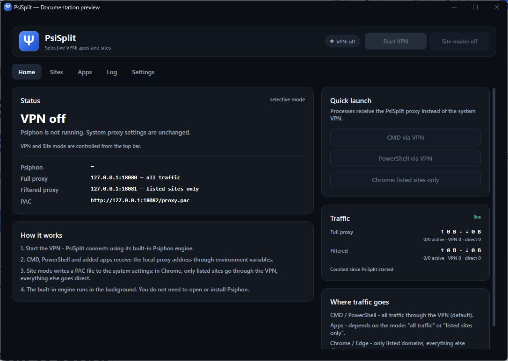
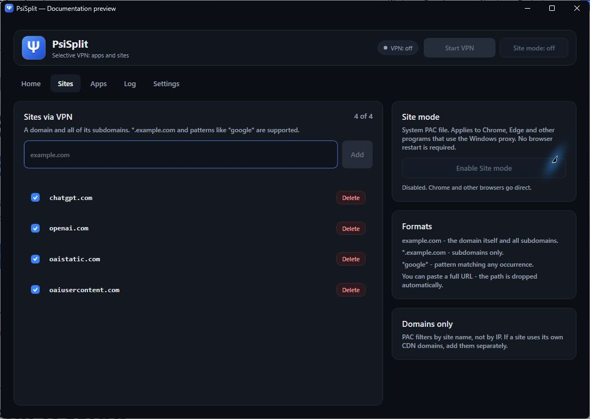
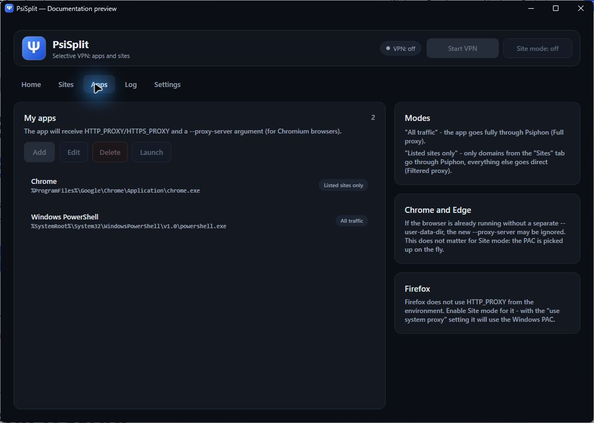
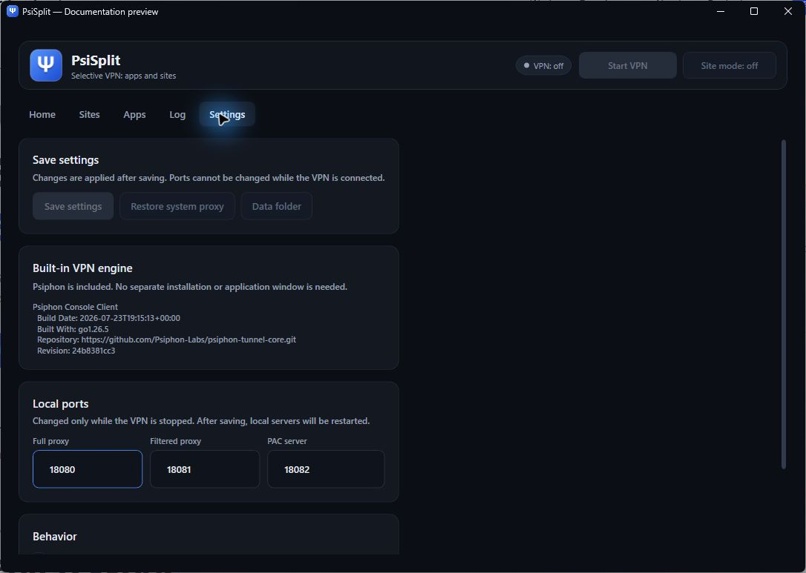
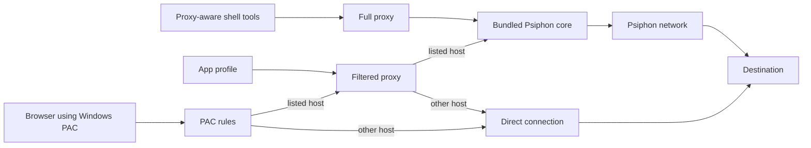

# PsiSplit

**Selective Psiphon routing for Windows — one desktop app, a built-in tunnel engine, and separate rules for apps and sites.**

[](https://github.com/eturchin/PsiSplit/actions/workflows/build.yml)
[Download for Windows](https://github.com/eturchin/PsiSplit/releases/latest) · [How it works](docs/architecture.md) · [Build from source](docs/development.md) · [Privacy](docs/privacy.md)

PsiSplit connects through Psiphon without opening or requiring the separate `psiphon3.exe` application. Its WPF interface manages the bundled engine, local proxies, browser site rules, application profiles, and traffic counters.

It is a **proxy-based routing tool**. Apps must honor the supplied proxy settings. The UI's **All traffic** mode means all requests that an app sends to the PsiSplit proxy; it does not intercept every network packet from that process. See [routing limits](#routing-limits) before choosing a mode.

## Screenshots

Real application captures from the offline `--preview` mode, using demonstration profiles. No live connection, user app list, account details, or private file paths are shown. Connection controls are disabled in preview.

| Home | Sites |
| --- | --- |
|  |  |
| Apps | Settings |
|  |  |

## Features

- **Built-in Psiphon engine.** Run PsiSplit alone; the tunnel core runs as a background process without a separate window.
- **Two routing modes.** Send all proxy requests through the tunnel, or tunnel only hosts matching your site list.
- **Browser Site mode.** Apply a Windows PAC file so compatible browsers use the tunnel for listed domains and connect directly to other sites.
- **App profiles.** Save programs, arguments, and a routing mode. Chromium browsers also receive an explicit proxy argument.
- **Shell shortcuts.** Launch CMD or PowerShell with proxy environment variables inherited by compatible tools and child processes.
- **Traffic visibility.** See byte counts, active/total connections, and tunneled/direct route counts for each local proxy.
- **Tray operation.** Keep routing active while the main window is hidden; exit from the tray menu when finished.
- **Isolated engine ownership.** Stop only the core managed by this PsiSplit profile. Other Psiphon instances are left alone.
- **Portable Windows build.** The release includes .NET and the engine; a separate runtime installation is unnecessary.

## Quick start

1. Download `PsiSplit-win-x64.zip` from [Releases](https://github.com/eturchin/PsiSplit/releases/latest).
2. Extract the archive and run `PsiSplit.exe` on Windows 10/11 x64.
3. Click **Start VPN** and wait for **VPN connected**. Initial connection time varies with the network.
4. Choose how to route traffic:
   - Use **CMD via VPN** or **PowerShell via VPN** for proxy-aware command-line tools.
   - Add a program on **Apps**, choose its mode, and launch it through PsiSplit.
   - Add domains on **Sites** and enable **Site mode** for browsers using the Windows proxy.
5. Close the window to minimize to the tray, or use the tray menu to exit. This behavior is configurable.

Site mode is enabled automatically after connecting by default. Disable that option on **Settings** if you only want explicitly launched apps to use PsiSplit.

For a source checkout, build with the .NET 8 SDK on Windows:

```powershell
dotnet build PsiSplit.sln -c Release
./publish.ps1
```

The new executable is written to `dist/standalone/PsiSplit.exe`. Publishing does not stop running apps or replace the original `dist/PsiSplit.exe`.

## How traffic is routed

| Entry point | Local endpoint | Behavior |
| --- | --- | --- |
| Shell/app in **All traffic** mode | HTTP proxy `127.0.0.1:18080` | Every request received by this proxy goes through the Psiphon core. |
| App in **Listed sites only** mode | HTTP proxy `127.0.0.1:18081` | Matching hosts use the core; other hosts connect directly. |
| Compatible browser in **Site mode** | PAC at `http://127.0.0.1:18082/proxy.pac` | Matching hosts use the filtered proxy; other hosts use `DIRECT`. |
| Traffic that does not use these settings | No interception | Uses the app's existing network configuration. |

The engine's own HTTP and SOCKS ports are separate, selected by Windows at startup, and bound to loopback. PsiSplit reads them from the core's JSON notices instead of depending on the official client's registry or default ports.



HTTPS uses HTTP `CONNECT` relays. PsiSplit does not install a certificate or decrypt HTTPS payloads. The architecture, lifecycle, recovery behavior, and source modules are described in [docs/architecture.md](docs/architecture.md).

## Site rules

| Rule | Matches |
| --- | --- |
| `example.com` | The domain itself and all subdomains. |
| `*.example.com` | Subdomains, excluding the apex domain. |
| `*example*` | A hostname wildcard pattern. |
| `*` | Every hostname received by the filtered proxy. |
| A full URL | Normalized to its hostname when added. |

Disabled rules are ignored. Rules match hostnames, not URL paths or destination IP ranges. When the site list changes, PsiSplit refreshes the PAC content and its versioned URL so compatible clients can reload it.

The default profile includes `chatgpt.com`, `openai.com`, `oaistatic.com`, and `oaiusercontent.com`. Sites may need additional domains for authentication, CDNs, or downloads. The supplied engine bootstrap selects Netherlands as its exit region; the public bootstrap can be refreshed at build time.

## App and browser behavior

**App profiles:** PsiSplit supplies `HTTP_PROXY`, `HTTPS_PROXY`, `ALL_PROXY`, and a local bypass list. These settings affect only programs that support them. Save paths using environment variables where practical; the [sample configuration](docs/examples/config.example.json) contains no machine-specific paths.

**CMD and PowerShell:** child processes inherit the proxy environment. PowerShell additionally receives default proxy settings for its web commands and .NET HTTP clients. Programs with their own network stacks can still ignore these settings.

**Chromium browsers:** profiles receive `--proxy-server` unless you already supplied an explicit proxy/PAC argument. An already-running browser can ignore new startup flags. Use Site mode, close that browser normally before relaunching it, or supply a separate browser profile.

**Firefox:** configure it to use the system proxy when using Site mode. Environment variables alone do not configure Firefox's browser proxy.

**Other Windows apps:** Site mode affects clients that honor the Windows PAC setting, including apps that were not launched by PsiSplit. Applications with independent proxy settings may behave differently.

## Settings and local data

| Location | Contents |
| --- | --- |
| `%APPDATA%/PsiSplit/config.json` | Sites, app profiles, local ports, and behavior preferences. |
| `%APPDATA%/PsiSplit/logs/` | Daily application logs; destinations and local app details can appear here. |
| `%APPDATA%/PsiSplit/proxy-backup.json` | Previous Windows proxy settings used for recovery. |
| `%LOCALAPPDATA%/PsiSplit/Tunnel/bin/<SHA256>/` | Extracted, integrity-checked engine resources and its license. |
| `%LOCALAPPDATA%/PsiSplit/Tunnel/data/` | The engine's private server cache and datastore. |
| `%LOCALAPPDATA%/PsiSplit/Tunnel/session.json` | Identity of the core owned by this PsiSplit profile. |

These are runtime locations, resolved on each machine. Personal settings, logs, IDE files, verification reports, and build outputs are excluded from version control. Public network bootstrap keys are intentionally included; account tokens and the official client's live datastore are not. See [privacy and repository contents](docs/privacy.md).

## Routing limits

- This is not a device-wide packet VPN, firewall, virtual network adapter, or per-process packet interceptor. UDP, games, and programs that ignore proxies are not automatically tunneled.
- There is no kill switch. The generated PAC deliberately includes a `DIRECT` fallback, and Site mode is disabled after a detected tunnel failure. Do not rely on it to prevent direct connections.
- A selected request arriving at PsiSplit's own proxy receives an error if the core is unavailable; the proxy does not silently reroute that request directly. Browser PAC fallback is a separate behavior.
- DNS and proxy support depend on the client and chosen route. PsiSplit does not claim system-wide DNS or leak prevention.
- Loopback proxies have no authentication; other local processes can access them. They are not exposed as LAN services by default.
- Exit availability, speed, authentication challenges, and destination access depend on the Psiphon network and the destination service.

## Troubleshooting

| Symptom | What to check |
| --- | --- |
| Connection stays pending | Check the internet connection and **Log**; try again when the network changes. |
| Local services cannot start | Another process may occupy a configured port. Choose distinct ports in **Settings** and restart PsiSplit normally. |
| Browser ignores an app profile | An existing browser instance may have ignored startup flags. Use Site mode or a separate profile. |
| A listed page loads partly | Add its authentication, asset, or CDN domains to **Sites**. |
| A program's IP does not change | Confirm that it supports the supplied HTTP proxy/environment settings. |
| Browser keeps an old PAC after a crash | Use **Restore system proxy**. Startup recovery also restores PsiSplit's saved proxy snapshot when applicable. |
| A program still uses a proxy after PsiSplit exits | Restart the program normally; inherited environment variables live for the lifetime of that process. |

## Development and tests

```powershell
# Local tests: matcher, PAC JavaScript, bundle checks, notices, fake HTTP upstream.
dotnet run --project src/PsiSplit.SelfTest -c Release -- --local

# Real network tests with independent cores, temporary profiles, and free ports.
# No system PAC is applied, and existing sessions are preserved.
dotnet run --project src/PsiSplit.SelfTest -c Release -- --isolated

# Offline UI preview for documentation; it can coexist with a live session.
dotnet run --project src/PsiSplit.App -c Release -- --preview
```

The default self-test is the isolated integration test. The separate `--system-proxy` test is opt-in and refuses to run while PsiSplit or Psiphon is active. CI runs the local suite and publishes a Windows build artifact; it does not connect to the public tunnel network.

See [development instructions](docs/development.md) for engine imports, publishing, CI, safe verification, and the project layout.

## Third-party components

PsiSplit includes an unmodified Psiphon tunnel core, its public bootstrap, and the distribution's seed server list. Psiphon is developed by Psiphon Inc. and contributors and distributed under GPL version 3 or later. The upstream license, exact revision, file hashes, and corresponding source links are recorded in [THIRD-PARTY-NOTICES.md](THIRD-PARTY-NOTICES.md) and [the bundled license](src/PsiSplit.Core/Resources/Psiphon/LICENSE.txt).

PsiSplit is an independent project and is not an official Psiphon client. The source is published here without an additional license grant for PsiSplit's original code; the third-party components retain their stated licenses.
